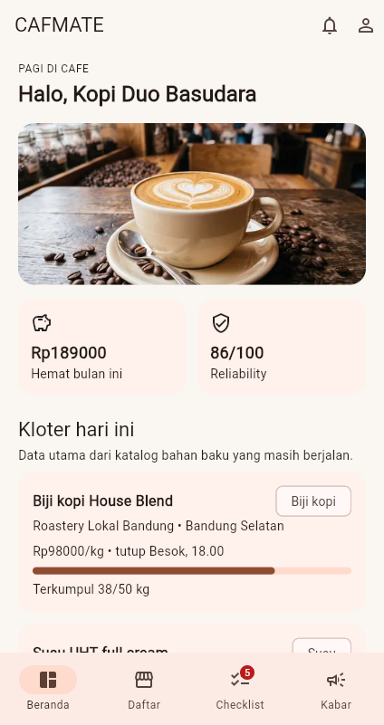
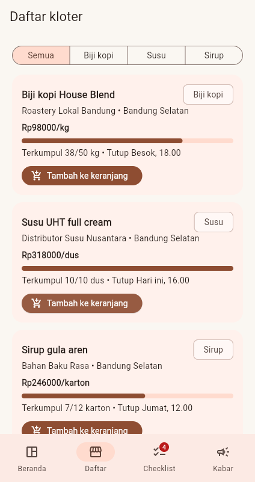
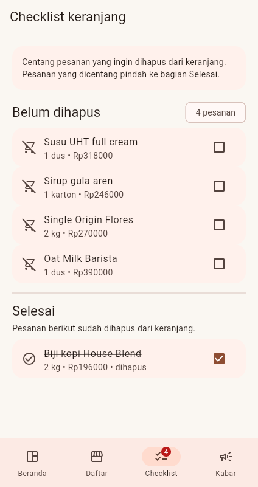
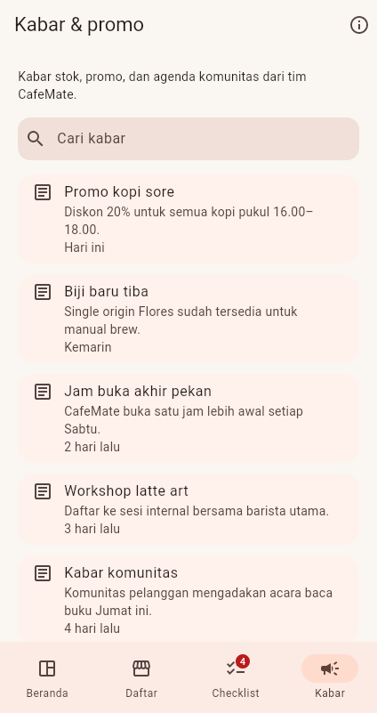
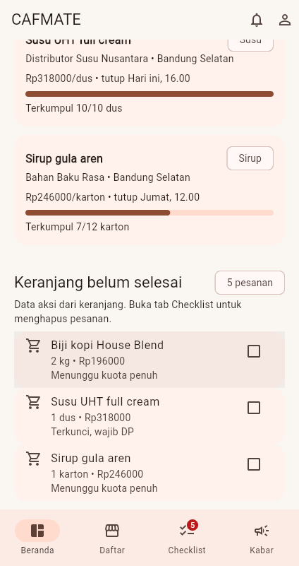
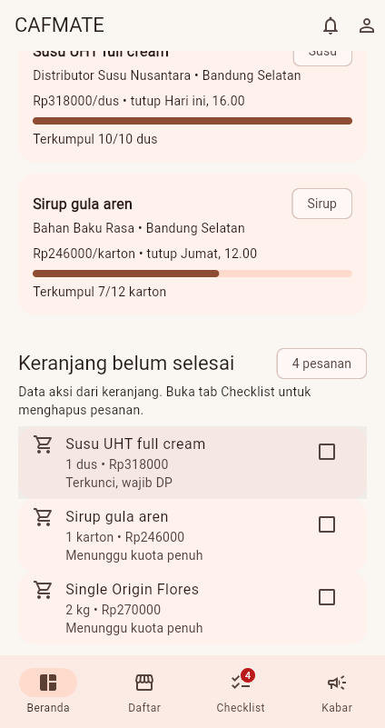

# CAFMATE — Group Buying & Mitigasi Limbah Bahan Baku Kopi

**Nama aplikasi:** CAFMATE (`cafemate`)
**Tema:** Platform B2B pengadaan bahan baku kolektif (*group buying*) dan mitigasi pemborosan stok untuk kedai kopi rintisan serta pedagang kopi gerobakan.

**Alasan memilih tema:**
Kedai kopi rintisan dan pedagang gerobakan sering kesulitan membeli biji kopi, susu, dan sirup dengan harga grosir karena volume pembelian dan kapasitas penyimpanannya terbatas. CAFMATE mempertemukan kebutuhan sesama pelaku usaha kopi mikro dalam satu kloter belanja kolektif agar modal operasional lebih ringan dan target MOQ tetap tercapai. Selain itu, aplikasi mencatat pesanan yang harus dihapus dari keranjang secara sadar agar stok yang tidak terpakai tidak menumpuk menjadi limbah bahan baku.

---

## Pemetaan Struktur Data

| Jenis Data | Model di `lib/domain/models/` | Penjelasan & Penerapan dalam Aplikasi |
| :--- | :--- | :--- |
| **Data Utama** | `CafmateProduct` (`cafmate_product.dart`) | Katalog bahan baku per kategori (Biji kopi, Susu, Sirup) beserta supplier, harga grosir, jadwal tutup kloter, dan progres kuota MOQ. Ditampilkan di tab **Beranda** dan **Daftar**. |
| **Data Aksi** | `CafmateOrder` (`cafmate_order.dart`) | Pesanan yang berada di keranjang. Item dicentang lewat `CheckboxListTile` di tab **Checklist** (dan di ringkasan Beranda), lalu pindah ke bagian **Selesai** dan badge tab berkurang. Model ini memiliki `copyWith()`. |
| **Data Informasi** | `CafeInfo` (`cafe_info.dart`) | Kabar promo, stok baru, agenda, dan pengumuman komunitas yang tampil di tab **Kabar** beserta pencarian. |

Ketiga model memiliki field `final`, `fromJson()`, dan hanya `CafmateOrder` (data aksi) yang dilengkapi `copyWith()`.

---

## Fitur Buatan Sendiri: Kabar & Promo

Tab **Kabar** adalah fitur mandiri yang mengambil data informasi hanya dari
`CafeInfoRepository` (tidak digabung dengan repository lain). Halaman ini menampilkan lima
kabar cafe dan memiliki kolom pencarian yang memfilter judul maupun ringkasan secara
langsung lewat `InfoViewModel`. Fitur ini dipilih karena pengumuman promo dan ketersediaan
stok baru adalah informasi yang paling sering dicari pemilik kedai sebelum ikut kloter
belanja.

---

## Struktur Proyek

```text
lib/
├── main.dart
├── app.dart
├── config/
│   └── dependencies.dart
├── domain/
│   └── models/
│       ├── cafmate_product.dart   # data utama
│       ├── cafmate_order.dart     # data aksi
│       └── cafe_info.dart         # data informasi
├── data/
│   ├── services/
│   │   └── cafemate_service.dart
│   └── repositories/
│       ├── product_repository.dart
│       ├── order_repository.dart
│       └── cafe_info_repository.dart
└── ui/
    ├── core/
    ├── shell/
    │   └── app_shell.dart
    ├── home/
    ├── catalog/
    ├── checklist/
    └── info/
```

Empat halaman berada dalam satu `NavigationBar` di `ui/shell/app_shell.dart`:
**Beranda**, **Daftar**, **Checklist**, dan **Kabar**. Service, seluruh repository, dan
empat ViewModel didaftarkan lewat `MultiProvider` di `config/dependencies.dart`.
`OrderRepository` adalah `ChangeNotifier`, sehingga mencentang item langsung memperbarui
Beranda dan badge tab Checklist.

> Catatan: `ui/admin/` dan `data/cafmate_store.dart` adalah fitur tambahan POV admin yang
> sudah ada sebelumnya; alur utama tugas tetap memakai empat halaman di atas.

---

## Dokumentasi Tampilan

### Screenshot Setiap Tab

| Beranda | Daftar |
| :---: | :---: |
|  |  |

| Checklist | Kabar |
| :---: | :---: |
|  |  |

### Beranda Sebelum dan Sesudah Item Dicentang

| Sebelum Item Dicentang | Sesudah Item Dicentang |
| :---: | :---: |
|  |  |

Pada screenshot sebelum, keranjang berisi **5 pesanan** (badge tab Checklist menunjukkan
angka 5). Setelah item **Biji kopi House Blend** dicentang di Beranda, pesanan tersebut
hilang dari daftar keranjang, pindah ke bagian **Selesai** di tab Checklist, dan badge
turun menjadi **4**.

---

## Hasil Pengujian (`flutter test`)

Perintah dijalankan pada direktori proyek:

```text
$ flutter test
00:02 +11: All tests passed!
```

Sebelas test mencakup `OrderRepository` (item pindah dari keranjang, badge berkurang,
status asli terjaga, pemuatan tidak ganda), `ChecklistViewModel` (item pindah ke Selesai,
hilang dari Beranda, badge berkurang), `InfoViewModel` (fitur Kabar), widget
`CafePhotoSlot`, dan `CafmateStore`.

---

## Menjalankan Aplikasi

```bash
flutter pub get
flutter test
flutter run -d chrome
```

Untuk server web lokal:

```bash
flutter run -d web-server --web-hostname 0.0.0.0 --web-port 3000
```
