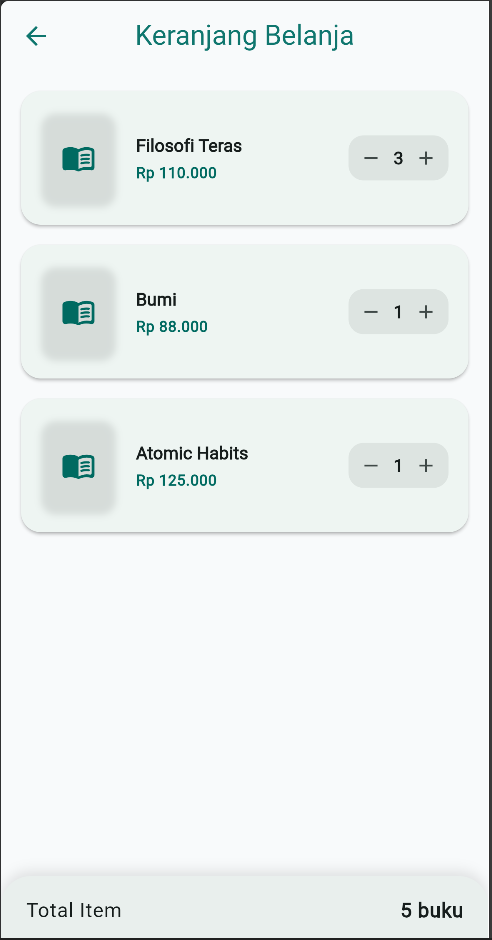
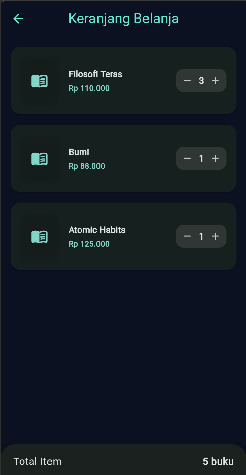
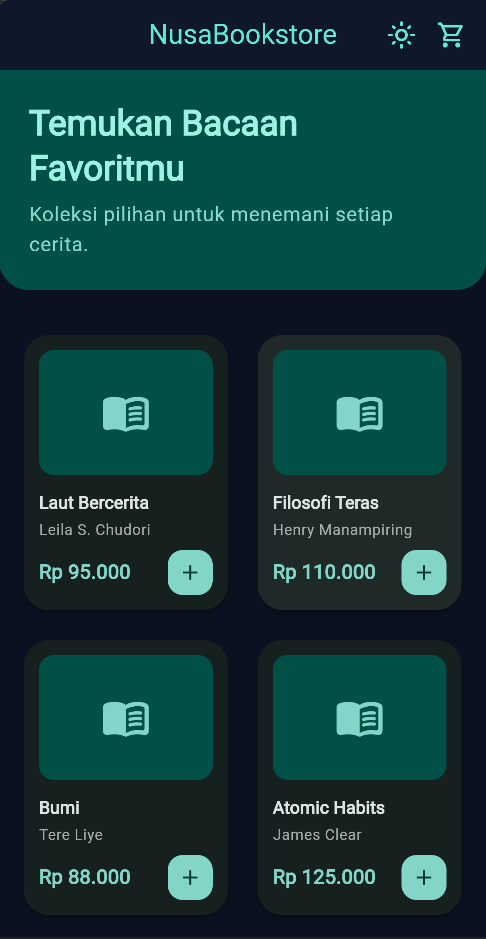

# NusaBookstore

Aplikasi katalog dan keranjang buku Flutter sederhana dengan state management
`provider`.

## Fitur

- Katalog empat buku dengan placeholder ikon.
- Tambah, kurangi, dan hapus buku dari keranjang.
- Badge jumlah item dan total pembayaran Rupiah yang reaktif.
- Checkout dengan `SnackBar` dan pengosongan keranjang.
- Light Mode dan Dark Mode di seluruh aplikasi.

## Struktur

```text
lib/
├── models/book.dart
├── providers/cart_provider.dart
├── providers/theme_provider.dart
├── screens/catalog_screen.dart
├── screens/cart_screen.dart
└── main.dart
```

## Screenshot

Screenshot hasil aplikasi:

| Katalog | Keranjang — Light Mode |
| --- | --- |
|  |  |

| Light Mode | Keranjang — Dark Mode |
| --- | --- |
|  |  |

| Dark Mode |
| --- |
|  |
