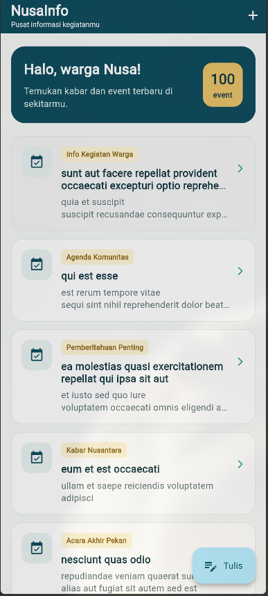
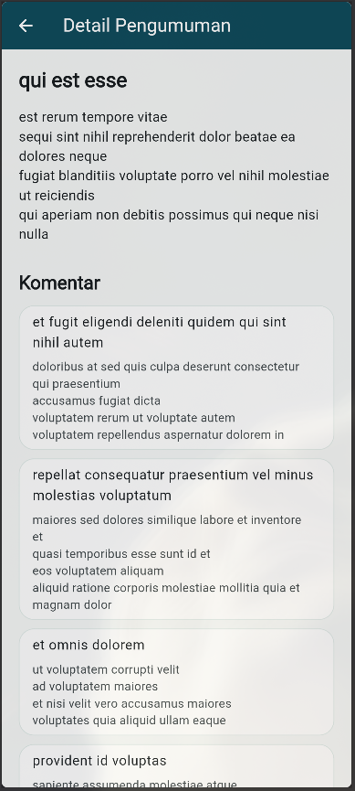
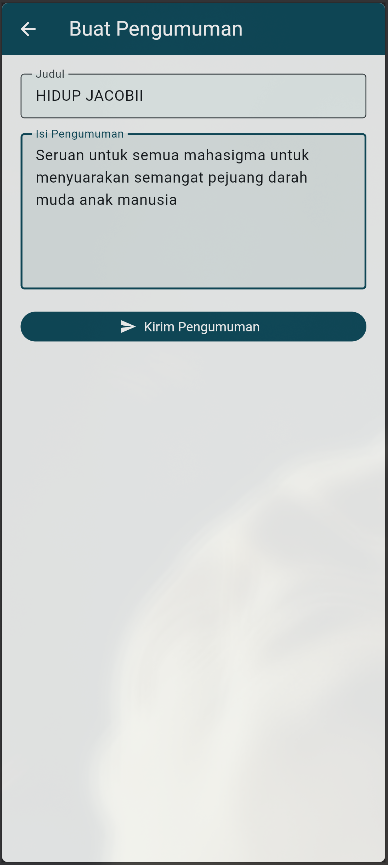
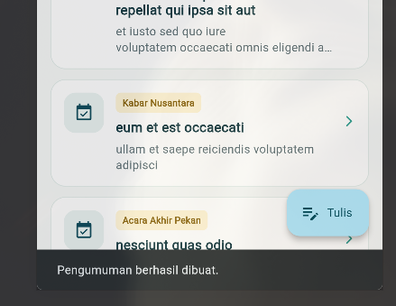
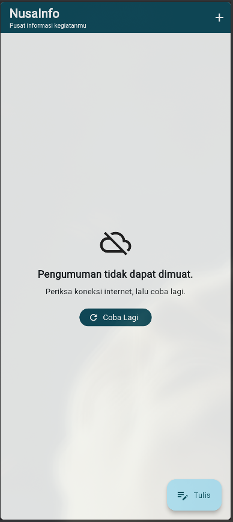
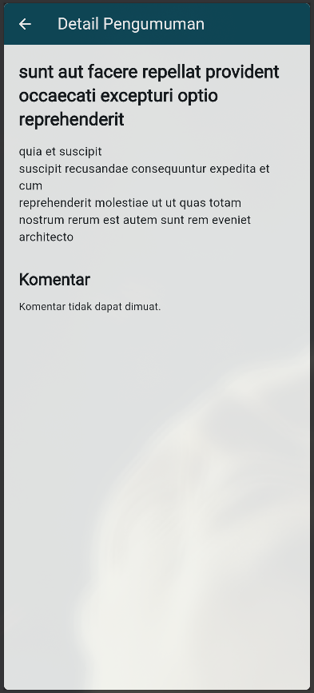
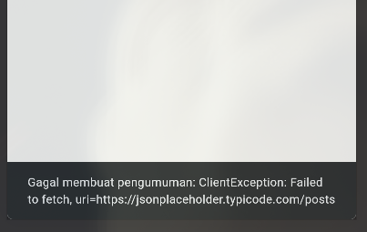

# nusa_info

A new Flutter project.

## Screenshots

### Home Screen

### Detail Screen

### Add Post Screen

### Snackbar Setelah Pengumuman Berhasil Dibuat

### Pesan Error Saat Internet Mati (Home)

### Pesan Error Saat Internet Mati (Detail)

### Snackbar Saat Gagal Karena Internet Mati

## Getting Started

This project is a starting point for a Flutter application.

A few resources to get you started if this is your first Flutter project:

- [Learn Flutter](https://docs.flutter.dev/get-started/learn-flutter)
- [Write your first Flutter app](https://docs.flutter.dev/get-started/codelab)
- [Flutter learning resources](https://docs.flutter.dev/reference/learning-resources)

For help getting started with Flutter development, view the
[online documentation](https://docs.flutter.dev/), which offers tutorials,
samples, guidance on mobile development, and a full API reference.
