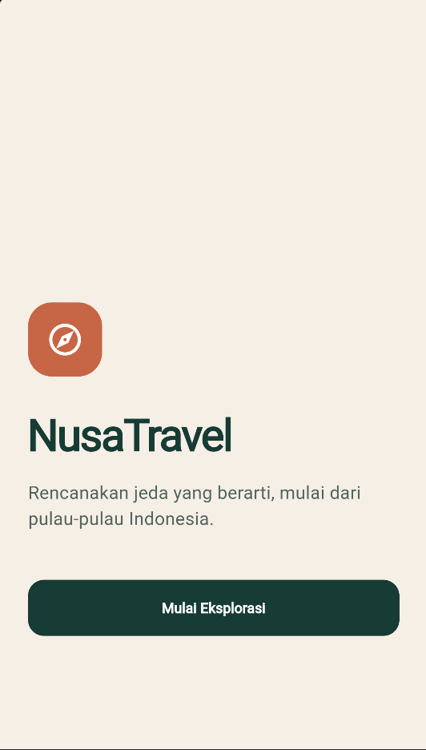
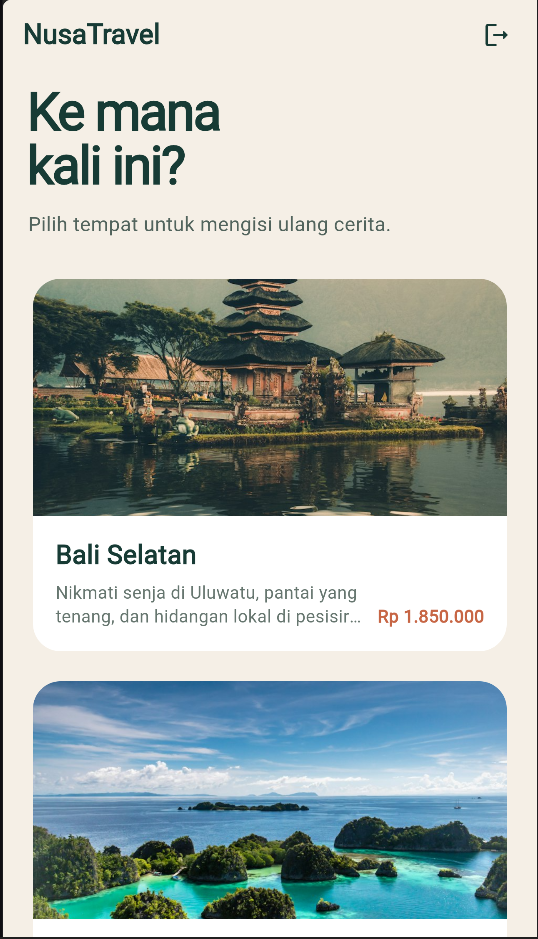
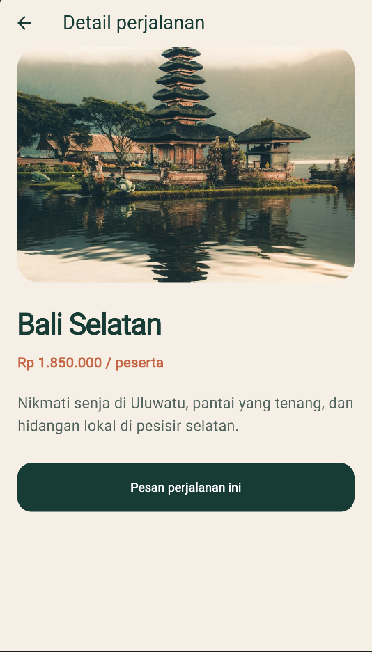
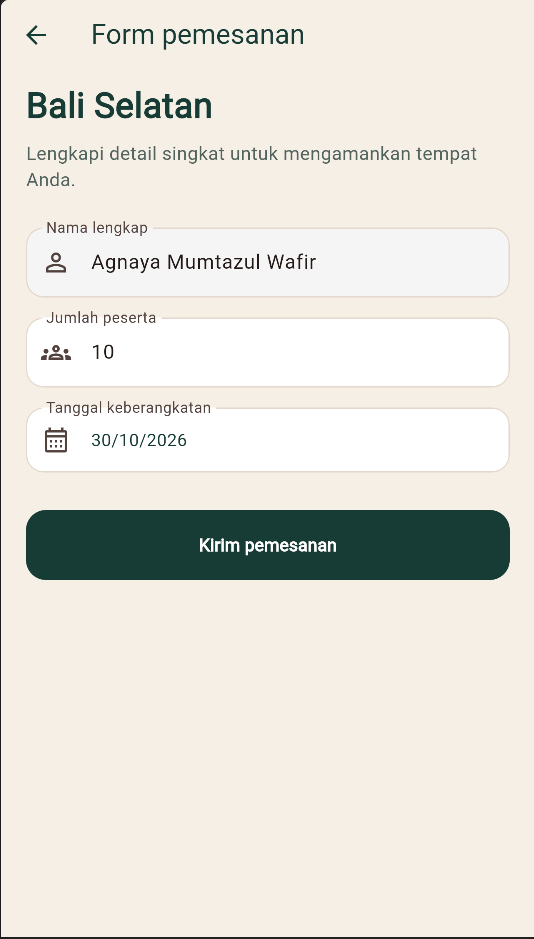
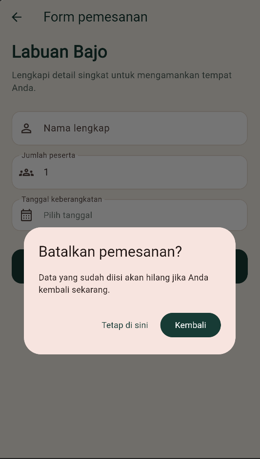
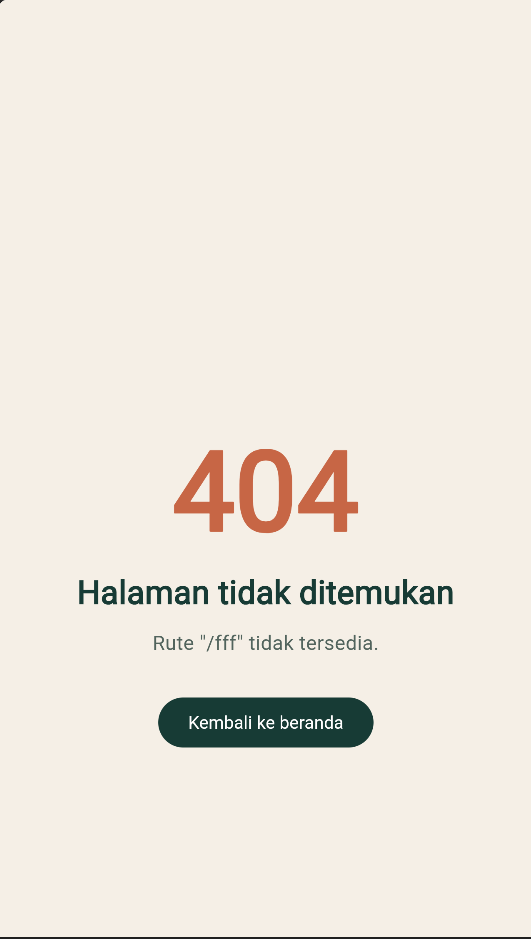

# NusaTravel

Aplikasi Flutter sederhana untuk menjelajahi paket wisata Indonesia dan mengirim pemesanan.

## Alur navigasi

- `/` menampilkan Splash Screen dan memakai `pushReplacementNamed()` ke Home.
- `/home` menampilkan empat paket wisata dan tombol Logout.
- `/detail` menerima `TourPackage` melalui `arguments`.
- `/booking` menerima `TourPackage`, memvalidasi form, lalu mengembalikan `true` dengan `Navigator.pop()`.
- Rute yang tidak dikenal ditangani oleh `onUnknownRoute` dan menampilkan Error 404.

## Struktur

Model, route, dan setiap screen dipisah ke folder `lib/models`, `lib/routes`, dan `lib/screens`.

### Splash Screen

### Home Screen

### Detail Screen

### Booking Screen

### Dialog PopScope

### Not Found Screen

